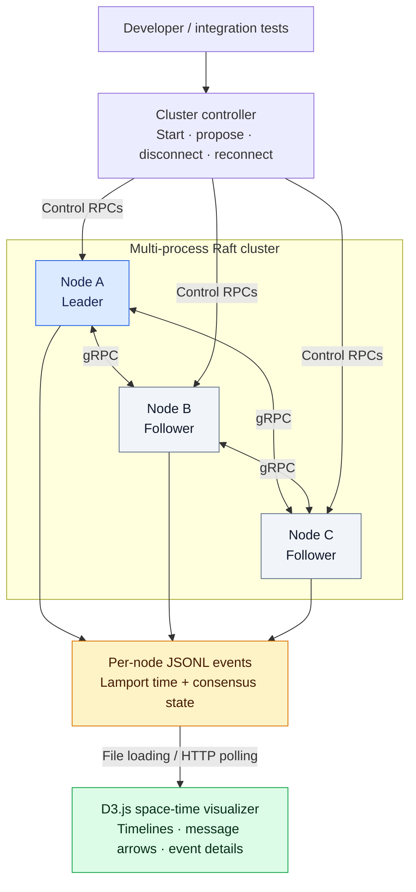
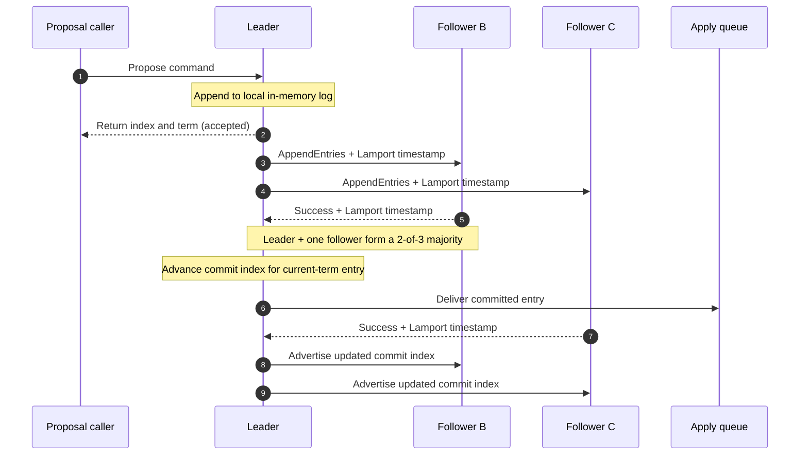
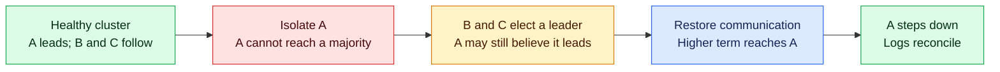

# RaftScope

### Making distributed consensus visible

**A C++20 Raft consensus prototype with causal event logging and an interactive browser visualizer.**

C++20 · gRPC · Protocol Buffers · Lamport Clocks · D3.js · GoogleTest

*University of Southern California · CSCI 546: Distributed Systems · Spring 2026*

---

## Overview

When several servers must agree on the same sequence of operations, failures become difficult to explain. A leader can lose contact with its peers, followers can fall behind, and competing candidates can trigger repeated elections. Individual log files show only fragments of the execution.

**RaftScope connects those fragments.** It combines a Raft consensus implementation with logical-clock instrumentation and a browser-based space-time diagram. Engineers can inspect elections, follow replication across nodes, and explore how a cluster behaves when communication is interrupted.

> This repository is a documentation-only project showcase. It contains the project overview and diagrams; application source code, test binaries, and runnable demos are not included.

## At a glance

| Area | What the project contains |
|---|---|
| **Consensus** | Leader election, replicated logs, majority-based commit advancement, and conflict-term backtracking |
| **Causal observability** | Lamport timestamps propagated through RPCs and structured per-node JSONL event logs |
| **Visualization** | D3.js node timelines, message arrows, event inspection, filters, and 2-second log polling |
| **Fault exploration** | Multi-process cluster controls for disconnecting and reconnecting nodes |
| **Testing** | 16 integration test definitions and 6 active queue unit tests |
| **Example data** | Three scenario families covering leadership transitions, follower lag, and split-vote elections |

## System architecture

The project separates consensus traffic from test controls. Each node runs its own process, exchanges gRPC messages with peers, and records selected protocol events. The visualizer reads those logs through local file loading or HTTP polling.

*Illustrative three-node topology. Roles change as elections occur.*

## How a proposal becomes committed

A leader accepts a proposal, appends it locally, and replicates it to followers. Followers check the previous log index and term before accepting entries. The leader advances its commit index once a majority has replicated an eligible current-term entry.

*This diagram illustrates one possible successful execution. Proposal acceptance is distinct from commitment; follower acknowledgments can arrive in either order.*

### Consensus mechanisms

- **Leader election:** randomized 250–500 ms timeouts, self-voting, peer vote requests, and log-freshness checks.
- **Replication:** AppendEntries consistency checks, conflicting-suffix truncation, and per-follower replication progress.
- **Commit advancement:** majority replication with a current-term check.
- **Recovery optimization:** conflict term/index replies let a leader skip divergent log segments instead of backing up one entry at a time.
- **Concurrent execution:** separate election, heartbeat, and apply workers; outgoing RPCs run outside the main consensus-state lock.

## From raw events to a useful timeline

Every recorded event includes its node, logical timestamp, event type, term, log index, commit index, and role. Message events also identify their source and destination.

**Lamport clocks preserve causal ordering without requiring synchronized machine clocks:** a local/send event increments the counter; receipt of a message advances it to `max(local, received) + 1`.

The browser organizes these events into one vertical timeline per node. Distinct logical timestamps occupy rows, while message arrows help connect activity across nodes. Clicking an event reveals its state; filters let users focus on elections, replication, or lifecycle activity.

| Visualizer capability | Why it matters |
|---|---|
| Per-node timelines | Makes cross-node behavior easier to inspect together |
| Message arrows | Helps follow requests and responses through an execution |
| Event details and filters | Supports focused investigation of terms, roles, and log progress |
| Compressed logical-time rows | Collapses idle gaps instead of stretching the diagram |
| URL polling every 2 seconds | Supports observation while a cluster writes new events |
| Multi-file loading | Supports inspection of saved runs |

Heartbeats advance logical clocks but are omitted from event logs to reduce visual noise. The schema declares 15 event types spanning elections, replication, and lifecycle/connectivity events; not all declared types are wired into live logging.

**Correlation boundary:** the current renderer matches messages using endpoints, event type, and logical timestamps. This is a heuristic rather than unique-message-ID correlation. A lower Lamport timestamp alone does not prove that one event caused another.

## Exploring a network partition

The control harness can block RPC communication and later restore it. This allows inspection of a leader losing its majority, a new election on the connected side, and eventual convergence after communication resumes.

*Conceptual recovery workflow. The checked-in fault scripts use fixed node IDs, so the exact outcome depends on which node actually wins the randomized election.*

The project includes both hand-authored illustrative logs and saved cluster scenario logs:

| Scenario | What it helps explain |
|---|---|
| **Leadership transition / “split-brain” window** | Nodes can temporarily hold different leadership beliefs across terms; an isolated old leader cannot make majority progress |
| **Follower lag / stale-read risk** | A disconnected follower can miss newly committed entries until it reconnects |
| **Split-vote elections** | Competing candidates can delay progress until a candidate wins a majority |

These scenarios are debugging aids. The project does not implement a client read API, so the follower-lag scenario does not itself demonstrate an executed stale read. The live election scenario also does not deterministically force livelock.

## Engineering decisions and tradeoffs

| Decision | Benefit | Tradeoff |
|---|---|---|
| Release the state lock before outgoing RPCs | Slow peers do not monopolize local consensus state | Replies must be revalidated against the current role and term |
| Atomic compare-exchange for logical-clock updates | Prevents concurrent updates from losing clock progress | Logical time still cannot identify all causal relationships by itself |
| Apply entries outside the consensus lock | A blocking application queue does not hold up consensus-state access | Completion and shutdown require careful coordination |
| Term-based log backtracking | Can reduce recovery retries across divergent log segments | Adds follower conflict metadata and leader-side recovery logic |
| Flush JSONL events after each write | Makes recent events available for inspection | Adds synchronous I/O overhead |
| File-based browser ingestion | Simple to inspect saved runs and observe a local cluster | Polling reloads full files; rendering currently rebuilds the SVG |

## Validation and tooling

The source repository contains **16 integration tests** covering initial elections, re-elections, leadership churn, agreement, concurrent proposals, partitions, rejoining nodes, and RPC byte/count budgets. Election test configurations include three, five, and seven nodes. **Six queue unit tests** cover buffered and unbuffered send/receive behavior.

A documentation review also parsed **19 saved JSONL files containing 332 event records**. These figures describe the included test and data artifacts, not benchmark results or a fresh test pass count.

The team report records successful runs of six required election tests. The C++ suite was not rerun during the documentation review; no throughput or latency benchmark is claimed here.

Optional tooling in the source project includes:

- OpenTelemetry gRPC tracing and OTLP export.
- Docker Compose configurations for Grafana/Tempo/Loki/Alloy or Jaeger with an OpenTelemetry Collector.
- DDB distributed-debugging integration.
- gRPC traffic capture/replay helper scripts.

## Technology stack

| Layer | Technologies |
|---|---|
| Consensus and concurrency | C++20, threads, mutexes, atomics, condition variables |
| Transport and schemas | gRPC, Protocol Buffers |
| Causal instrumentation | Lamport logical clocks, JSONL, spdlog |
| Browser interface | JavaScript, HTML/CSS, D3.js v7, SVG |
| Tests and build | GoogleTest, CMake, Abseil |
| Automation | Python, Bash, POSIX process tooling |
| Optional observability | OpenTelemetry, Docker Compose, Grafana stack, Jaeger |

## Scope and next steps

RaftScope is an educational systems prototype with in-memory consensus state. It does not implement durable restart recovery, snapshots, dynamic membership, or a linearizable read service. Its development RPC services use insecure channels, and its detached worker lifecycle needs further hardening.

The most valuable next steps are exact message correlation, more complete event emission, improved synchronous-proposal completion signaling, managed worker shutdown, deterministic fault scenarios, and durable state storage. Larger traces would also benefit from incremental ingestion and rendering.

## Team and context

Developed for **CSCI 546: Distributed Systems at the University of Southern California**, Spring 2026, by:

- **Karthik Venugopal**
- **Akshay Shivashankar Bharadwaj**
- **Adithya Sudhindra**

The project extends the course's Raft skeleton. The team report discloses AI assistance in implementing the browser visualizer. This showcase describes the team's system and does not assign individual ownership of every component.

---

**RaftScope brings consensus behavior into view: from a proposal, through replication, to the events that explain what happened across the cluster.**
